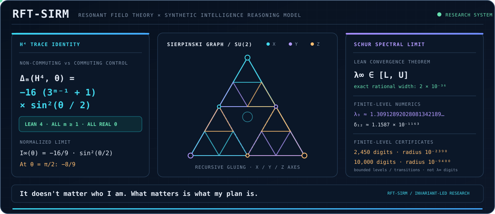

# RFT-SIRM

**Independent research in recursive mathematics, spectral theory, formal verification, and systems architecture.**

## Research identity

**RFT** means *Resonant Field Theory*. **SIRM** means *Synthetic Intelligence Reasoning Model*.

SIRM is the reasoning and systems framework developed alongside this research: mathematical and operational states are described through explicit constraints, transitions are examined against those constraints, and results are accompanied by inspectable proofs, code, computational records, and stated limitations.

The work is organized as connected but independently scoped research strands. A result in one strand is not treated as evidence for another.

## Mathematical results

### 1. Non-commuting SU(2) connections on Sierpiński-gasket graphs

For the specified non-commuting and commuting-control connection Laplacians, the fourth-moment trace defect is

\[
\Delta_m(H^4,\theta)
=
\operatorname{Tr}(H_C^4)-\operatorname{Tr}(H_{C'}^4)
=
-16(3^{m-1}+1)\sin^2\!\left(\frac{\theta}{2}\right),
\qquad m\geq 1.
\]

This is the principal all-level closed-form result in **Evgeny's Theorem**. The identity is machine-checked in Lean 4 for every refinement level \(m\geq1\) and every real angle \(\theta\).

The normalized invariant has the exact limit

\[
I_\infty(\theta)=-\frac{16}{9}\sin^2\!\left(\frac{\theta}{2}\right),
\qquad I_\infty(\pi/2)=-\frac{8}{9}.
\]

Higher moments H⁶, H⁸, and H¹⁰ have separate results and narrower evidence boundaries; their status is documented individually rather than inferred from the H⁴ theorem.

[**Evgeny's Theorem — theorem, proof, and Lean formalization →**](https://github.com/RFT-SIRM/Evgeny-Theorem)

### 2. Schur recursion and the limiting spectral constant

**Phi-Genesis** studies least eigenvalues of recursively defined Sierpiński-gasket graph Laplacians. Lean 4 proves least-eigenvalue identification and convergence for the stated level sequence \(N\geq6\), with the limit enclosed in an exact rational interval:

\[
\lambda_\infty\in[L,U],
\qquad U-L=2\times10^{-36}.
\]

The signed local-face matrices are transferred to the signless model by a proved gauge equivalence.

A finite-level Schur computation gives

\[
\lambda_9\approx
1.3091289202808134218886230881708101885523\ldots
\]

This decimal is a numerical value for the **finite level** \(N=9\), not a certified decimal expansion of the infinite-level limit.

[**Phi-Genesis — spectral-limit proof map →**](https://github.com/RFT-SIRM/Phi-Genesis/blob/main/computational/spectral_gap_theta_2pi/PROOF_MAP.md)

## High-precision computational records

The spectral programme keeps numerical calculations and finite computer-assisted certificates distinct from all-level Lean theorems.

| Record | Computation and scope |
|---|---|
| **1,250-digit Schur recursion** | Finite-level A₁ and E-sector calculations through level 12; the level-12 increment is approximately \(1.1587\times10^{-1163}\). |
| **2,450-digit interval / inertia certificates** | Outward-rounded finite-level brackets and eigenvalue ordering for levels 1–12; reported bracket radius \(10^{-2390}\). |
| **10,000-digit derivative certificate** | Finite transitions 5→13, with certified root ordering, positive pivots, curvature, and derivative bounds; reported radius \(10^{-9400}\). |

These precision settings describe finite calculations and certificates. They do **not** mean that the infinite-level limit is known or proved to 2,450 or 10,000 decimal places. The exact Lean enclosure for the limit has width \(2\times10^{-36}\). The observed quadratic increment law remains numerical evidence, not an all-level theorem.

[**Full precision record and reproduction commands →**](https://github.com/RFT-SIRM/Phi-Genesis/blob/main/computational/spectral_gap_theta_2pi/PRECISION_RECORD.md)

## Further research and engineering directions

| Project | Scope | Current boundary |
|---|---|---|
| [RFT-QPU-Sierpinski](https://github.com/RFT-SIRM/RFT-QPU-Sierpinski) | Proposed Sierpiński/SU(2) superconducting quantum-processing architecture. | Pre-experimental modelling; no fabricated or measured chip is claimed. |
| [SIRM-Financial-Infrastructure](https://github.com/RFT-SIRM/SIRM-Financial-Infrastructure) | Lean 4 formal specification of financial state transitions, accounting, authorization, and escrow logic. | Formal model, not a deployed financial service. |
| [UltraCore-RFT](https://github.com/RFT-SIRM/UltraCore-RFT) | Central research map, evidence index, and links to the canonical workstreams. | Navigation and synthesis hub; individual repositories remain authoritative. |

## Evidence principles

The repositories distinguish four kinds of evidence:

- **FORMALIZED** — a proposition checked by the stated proof assistant and build.
- **CERTIFIED FINITE-LEVEL** — a computer-assisted certificate for explicitly bounded cases.
- **NUMERICALLY REPRODUCED** — a repeatable computation for stated finite inputs and parameters.
- **EXPLORATORY / OPEN** — a model, application direction, or claim for which further proof, replication, or physical validation remains necessary.

A numerical result is not silently promoted to a theorem; a finite certificate is not presented as an infinite-level proof; and a proposed engineering architecture is not described as a measured device.

## Start here

- [UltraCore-RFT — research and evidence map](https://github.com/RFT-SIRM/UltraCore-RFT)
- [Evgeny's Theorem — exact SU(2) trace identity](https://github.com/RFT-SIRM/Evgeny-Theorem)
- [Phi-Genesis — Schur recursion and spectral limit](https://github.com/RFT-SIRM/Phi-Genesis)
- [RFT-QPU-Sierpinski — proposed quantum architecture](https://github.com/RFT-SIRM/RFT-QPU-Sierpinski)
- [SIRM-Financial-Infrastructure — formal state model](https://github.com/RFT-SIRM/SIRM-Financial-Infrastructure)

---

*It doesn't matter who I am. What matters is what my plan is.*

**RFT-SIRM · Research, formalization, computation, and engineering**

